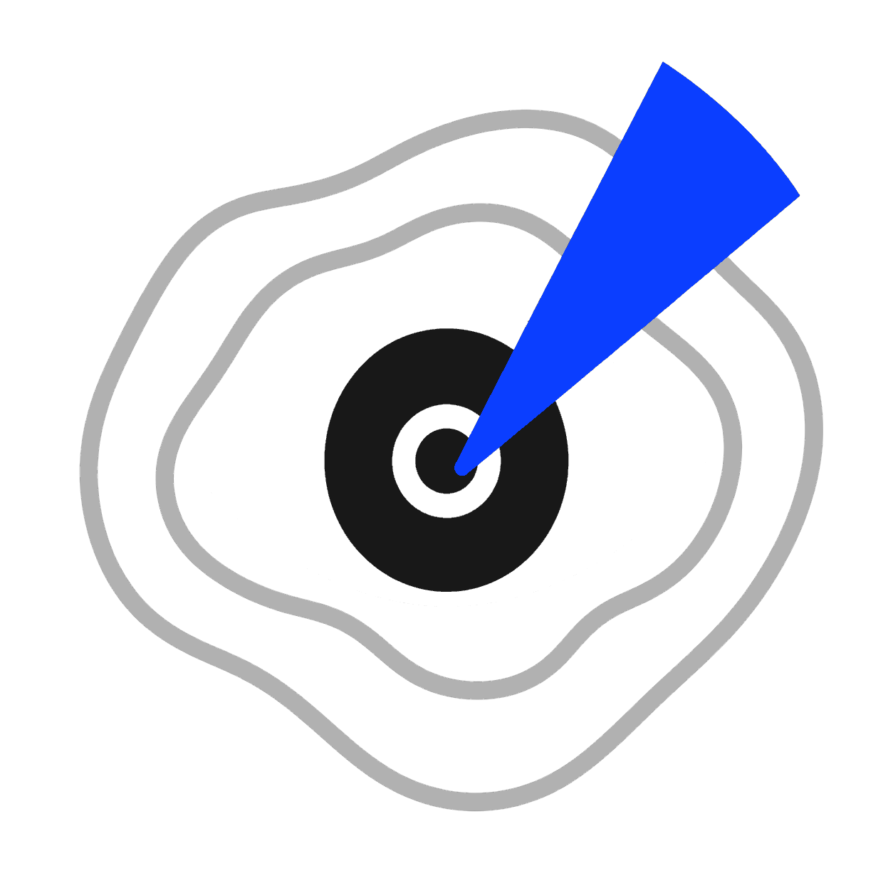

# Urban Viewshed Calculation



Urban Viewshed Calculation is a QGIS plugin for cumulative visibility analysis. It uses a terrain raster, building polygons, and building heights to calculate how many observer points can see each raster cell.

## How it works

1. The plugin reads the selected digital elevation model (DEM).
2. Building heights are rasterized and added to the terrain surface.
3. Observer points are placed along building boundaries at approximately 3 metre intervals.
4. Rays are sent from every observer point in all directions within the maximum analysis distance.
5. A cell is visible when its vertical angle is higher than the previous cells on the same ray.
6. Earth curvature is included in the height calculation.
7. The individual visibility rasters are added together.

The output is a GeoTIFF raster. Each cell value is the number of observer points from which that cell is visible. Cells with a value of zero are shown as transparent in QGIS.

## Inputs

- A DEM raster in a projected coordinate reference system.
- A polygon building layer.
- A numeric field containing non-negative building heights.
- An optional output path. If it is empty, QGIS creates a temporary GeoTIFF.

The DEM must have square, non-rotated pixels. Zero-valued DEM cells are treated as invalid data by the current implementation.

## Additional settings

The **Additional buildings** dialog can be used to:

- add another building layer to the analysis surface;
- change the maximum analysis distance (4,000 metres by default);
- add an observer height above the calculated surface;
- remove additional building footprints from the result.

## Requirements

- QGIS 3.32 or newer;
- NumPy;
- GeoPandas;
- Rasterio;
- Shapely.

These Python packages must be available in the Python environment used by QGIS. Package availability can differ between QGIS distributions and operating systems.

## Installation

Place the `vieshed_module` directory in the QGIS user plugin directory, or create a ZIP archive with `vieshed_module` as its top-level directory and use:

**Plugins → Manage and Install Plugins → Install from ZIP**

## Optional Numba acceleration

The current version runs the visibility functions as normal Python code. The source also contains a prepared optional loader for Numba and llvmlite, but it is disabled by default because their binary files must match the operating system, processor architecture, Python version, and QGIS build.

For local acceleration, create the matching directory:

```text
vieshed_module/
└── tools/
    ├── macos/
    └── windows/
```

Install compatible Numba and llvmlite packages into the relevant directory with the Python interpreter used by QGIS. For example:

```bash
<QGIS_PYTHON> -m pip install --target vieshed_module/tools/windows numba llvmlite
```

Use `tools/macos` instead of `tools/windows` on macOS. Do not copy binary packages from another operating system or Python version.

Adding the packages alone does not enable acceleration in the current source. The platform loader, the Numba import, and the two `@njit` decorators in `viewshed_module_handlers.py` must also be enabled. On signed macOS QGIS builds, an external llvmlite binary may be rejected by the system library validation.

## Third-party fonts

The optional UI fonts are distributed under the SIL Open Font License 1.1:

- [Anek Latin](https://github.com/google/fonts/tree/main/ofl/aneklatin)
- [Monomaniac One](https://github.com/google/fonts/tree/main/ofl/monomaniacone)

The plugin can run without these font files. Qt will use an available system font instead.

## Current limitations

- Visibility calculation can be slow without Numba, especially with many observer points or a large DEM.
- Rotated rasters and non-square pixels are not supported.
- A projected CRS is required.
- The calculation runs in the QGIS process and cannot be cancelled after it starts.
